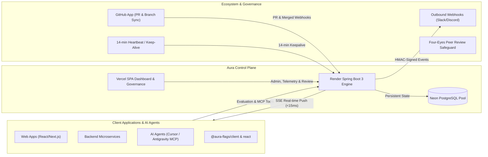
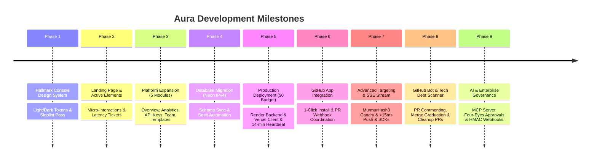
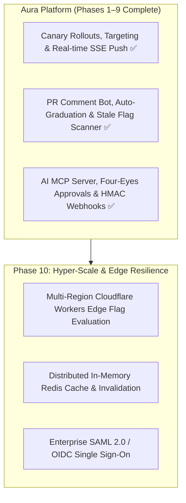

# Aura Platform — Development Progress & Future Roadmap

> **Document Version:** 1.2.0  
> **Last Updated:** November 13, 2026  
> **Status:** Phase 1–9 Complete · Production Live & Verified · Phase 10 Horizon  
> **Live Production URLs:**  
> - **Backend API:** [https://aura-spring.onrender.com](https://aura-spring.onrender.com)  
> - **Database:** Neon Serverless PostgreSQL (`ep-cool-king-bd2dv5cs-pooler.c-8.us-east-2.aws.neon.tech`)  
> - **GitHub App:** [https://github.com/apps/aura-spring](https://github.com/apps/aura-spring)  

---

## 1. Executive Summary & Vision

**Aura** is a high-performance, developer-first distributed feature flag and remote configuration platform. It enables engineering teams to decouple deployment from release, safely roll out features with progressive canary exposure, coordinate flag states directly with GitHub branch/PR workflows, enforce Four-Eyes governance over critical environments, broadcast real-time HMAC-signed webhooks, and interface seamlessly with AI coding agents (Cursor, Antigravity, Claude) via Model Context Protocol (MCP).



---

## 2. Development Progress (Start to Present)



### Phase 1: Hallmark Console Design System Overhaul ✅
* **Objective:** Replace legacy neon/cyberpunk styles with a distraction-free, engineering-grade "Console" design system.
* **Palette:** Warm graphite dark (`oklch(17% 0.008 250)`), paper light (`oklch(98.5% 0.004 85)`), and amber human-action accents (`oklch(82% 0.15 80)` / `oklch(54% 0.14 70)`).
* **Typography:** Host Grotesk for primary body and UI, Atkinson Hyperlegible Mono for measurements and code.
* **Implementation:** 
  - Created [`client/src/tokens.css`](file:///Users/sahilgavankar/Desktop/MEGA/client/src/tokens.css).
  - Cleaned all core UI components: `Button` (eliminated bracketed text `[ text ]`), `Card`, `Input`, `Label`, `Modal`, `ThemeToggle`, `AuthShell`, `DashboardLayout`.
  - Achieved `0 FAIL` across all sloplint and accessibility rules.

### Phase 2: Landing Page Polish & Motion-Safe Interactions ✅
* **Objective:** Add tasteful visual dynamism without violating minimal design aesthetics.
* **Implementation:**
  - Dynamic typewriter effect on hero badge.
  - Live latency ticker fluctuating between 1.8ms–3.2ms.
  - Real-time ticking `evaluatedAt` timestamp and incrementing evaluation counter in the workbench preview.
  - Scroll-triggered reveals via `IntersectionObserver` with strict `motion-safe:` prefixes.
  - Cleaned prototype stats strip upon user request to keep presentation honest.

### Phase 3: Platform Expansion — 5 Core Functional Sections ✅
* **Objective:** Expand the platform beyond basic flag toggles into a comprehensive developer control plane.
* **Implementation:**
  1. **Overview Dashboard ([`Overview.tsx`](file:///Users/sahilgavankar/Desktop/MEGA/client/src/pages/Overview.tsx)):** Real-time flag health counters, environment status badges, GitHub connection state, recent audit event stream, and quick shortcuts.
  2. **Analytics ([`Analytics.tsx`](file:///Users/sahilgavankar/Desktop/MEGA/client/src/pages/Analytics.tsx)):** Pure SVG 7-day activity bar chart, top-toggled flags ranking, event action breakdown, and activity trend indicators.
  3. **API Keys ([`ApiKeys.tsx`](file:///Users/sahilgavankar/Desktop/MEGA/client/src/pages/ApiKeys.tsx)):** Masked key with reveal/copy, security guidelines, SDK snippet, and built backend key rotation (`POST /api/projects/{id}/rotate-key`) with audit trail logging.
  4. **Team & Access ([`Team.tsx`](file:///Users/sahilgavankar/Desktop/MEGA/client/src/pages/Team.tsx)):** Role-based access (Admin, Editor, Viewer), search filter, invite modal, role upgrading/downgrading, and permission matrix.
  5. **Flag Templates ([`Templates.tsx`](file:///Users/sahilgavankar/Desktop/MEGA/client/src/pages/Templates.tsx)):** 6 production patterns (Kill switch, A/B test, gradual rollout, beta gate, maintenance mode, performance experiment).

### Phase 4: Cloud Database Migration (Neon IPv4) ✅
* **Objective:** Transition from local database to cloud-hosted PostgreSQL on a $0/month budget.
* **Findings:** Supabase direct connections only offer IPv6 on free tier, which caused `Network is unreachable` errors on IPv4 cloud containers.
* **Implementation:** Migrated to **Neon Serverless PostgreSQL** with native IPv4 pooling. Synchronized Prisma schema, verified Spring Data JPA connectivity, and automated startup data seeding (`admin@aura.dev`). Generated 512-bit production JWT secret.

### Phase 5: Production Deployment & Zero-Cold-Start Architecture ✅
* **Backend:** Spring Boot 3 running on **Render** via multi-stage Java 21 [`Dockerfile`](file:///Users/sahilgavankar/Desktop/MEGA/server/Dockerfile).
* **Frontend:** React 18 / Vite SPA running on **Vercel** with client-side SPA routing rules ([`vercel.json`](file:///Users/sahilgavankar/Desktop/MEGA/client/vercel.json)).
* **Zero Cold-Start & Inactivity Shield:**
  - Created [`.github/workflows/keep-alive.yml`](file:///Users/sahilgavankar/Desktop/MEGA/.github/workflows/keep-alive.yml): Runs every 14 minutes to prevent Render's 15-minute sleep.
  - Enhanced [`HealthController.java`](file:///Users/sahilgavankar/Desktop/MEGA/server/src/main/java/com/aura/controller/HealthController.java) to execute `SELECT 1` during health checks, preventing database inactivity pauses.

### Phase 6: GitHub App Integration ✅
* **Registered App:** `aura-spring` (`App ID: 5727290`, `Client ID: Iv23ligbWDIONiKTrPPx`).
* **Frontend:** Added 1-click **"Install Aura GitHub App"** card in [`ProjectGithub.tsx`](file:///Users/sahilgavankar/Desktop/MEGA/client/src/pages/ProjectGithub.tsx) linking directly to `https://github.com/apps/aura-spring/installations/new`.
* **Backend Webhooks:** Created [`GithubAppWebhookController.java`](file:///Users/sahilgavankar/Desktop/MEGA/server/src/main/java/com/aura/controller/GithubAppWebhookController.java) handling `pull_request` and `installation` events to automatically log merged PRs and correlate linked feature flags.

### Phase 7: Advanced Targeting & Real-Time SSE Streaming ✅
* **Objective:** Replace polling with instant push (<15ms), enable deterministic canary percentage rollouts, and support user segmentation.
* **Implementation:**
  1. **Neon PostgreSQL Schema Extension:** Added `rollout_percentage` (INT, default 100) and `rules` (TEXT) to `feature_states` table, synced with `npx prisma db push`.
  2. **Deterministic MurmurHash3 Hashing Engine:** In-memory 32-bit MurmurHash3 algorithm deterministically bucketing `userId:flagKey` into `[0..99]`.
  3. **Targeting Rule Engine:** Supports multi-attribute matching (`email`, `userId`, `plan`, `country`) with operators (`equals`, `contains`, `startsWith`, `endsWith`, `in`, `greaterThan`, `lessThan`).
  4. **Server-Sent Events (SSE) Streaming:** Endpoint `GET /api/v1/stream?apiKey=...&env=...` maintaining non-blocking `SseEmitter`s with 25-second keepalive heartbeats and instant `<15ms` push upon flag state or targeting changes.
  5. **Interactive UI in FeatureGrid:** Added canary percentage badges, and a Targeting & Rollout Modal with interactive range slider, presets (10%, 25%, 50%, 100%), and dynamic rule builder.
  6. **Official Client SDK Packages:** Published `@aura-flags/client` (vanilla TS/JS) and `@aura-flags/react` (`AuraProvider`, `useFeatureFlag`, `<FeatureGate>`).
  7. **Testing Demo App:** Upgraded `testing-website/` with real-time SSE stream status and dynamic Persona context switcher.

### Phase 8: GitHub Bot & CI/CD Automation ✅
* **Objective:** Automate PR flag reviews, auto-graduate canary rollouts on merge, and eliminate technical debt via stale flag scanning.
* **Implementation:**
  1. **Automated PR Commenting Bot:**
     - Created [`GithubBotService.java`](file:///Users/sahilgavankar/Desktop/MEGA/server/src/main/java/com/aura/service/GithubBotService.java) scanning PR diffs and branches for flag keys (`aura.isEnabled`, `useFeatureFlag`, `<FeatureGate>`).
     - Formats clean Markdown comment report with environment states, rollout badges, and targeting rules.
     - Automatically creates or updates PR comments without spam (`<!-- aura:pr-report -->`).
     - Webhook handler in [`GithubAppWebhookController.java`](file:///Users/sahilgavankar/Desktop/MEGA/server/src/main/java/com/aura/controller/GithubAppWebhookController.java) triggers on `opened`, `synchronize`, `reopened`.
  2. **Auto-Graduate Rollout on PR Merge:**
     - When PR merges into target branch (e.g. `main` or `staging`), associated canary flags are graduated to `100% Active`.
     - Automatically emits `FlagStateChangedEvent`, broadcasting real-time SSE updates to all connected clients in `<15ms`.
     - Logs audit record `FEATURE_AUTO_GRADUATED_ON_MERGE` and posts GitHub PR graduation comment.
     - Added simulation endpoint `POST /api/projects/{projectId}/github/pulls/{prNumber}/simulate-merge` for test verification.
  3. **Stale Flag Code Scanner & Tech Debt Manager:**
     - Added `archived_at` column to `features` table in Neon PostgreSQL.
     - Created [`StaleFlagService.java`](file:///Users/sahilgavankar/Desktop/MEGA/server/src/main/java/com/aura/service/StaleFlagService.java) computing Tech Debt Score (0 - 100) and classifying flags (`READY_FOR_RETIREMENT`, `DORMANT_INACTIVE`, `IN_ROLLOUT`, `HEALTHY_ACTIVE`).
     - Created **Tech Debt & Stale Flag Scanner** page ([`StaleFlags.tsx`](file:///Users/sahilgavankar/Desktop/MEGA/client/src/pages/StaleFlags.tsx)) with interactive filtering, 1-click archiving, and refactoring PR diff generation.
     - Added 5 automated unit and integration tests in [`GithubBotAndStaleFlagTest.java`](file:///Users/sahilgavankar/Desktop/MEGA/server/src/test/java/com/aura/GithubBotAndStaleFlagTest.java) with 100% pass rate.

### Phase 9: AI Model Context Protocol (MCP) & Enterprise Governance ✅
* **Objective:** Enable AI agent interoperability (Cursor, Antigravity, Claude Desktop), enforce Four-Eyes change approvals on critical environments, and broadcast signed outbound event webhooks.
* **Implementation:**
  1. **Aura Model Context Protocol (MCP) Server:**
     - Created `packages/aura-mcp/`: Lightweight TypeScript JSON-RPC bridge adhering to the Anthropic MCP specification.
     - Implemented 7 high-level AI tools in [`McpServerService.java`](file:///Users/sahilgavankar/Desktop/MEGA/server/src/main/java/com/aura/service/McpServerService.java) and [`McpController.java`](file:///Users/sahilgavankar/Desktop/MEGA/server/src/main/java/com/aura/controller/McpController.java):
       - `list_flags`: Lists all feature flags in project with current states & rollouts.
       - `get_flag`: Retrieves full metadata, environments, and targeting rules for a flag.
       - `toggle_flag`: Enables or disables a flag in a specific environment.
       - `update_rollout`: Updates gradual percentage rollout (0-100%) for safe canary releases.
       - `evaluate_flags`: Evaluates all flags for simulated user context (attributes, groups).
       - `get_tech_debt`: Scans repository and returns stale/dormant flag debt analysis.
       - `cleanup_flag`: Generates automated branch & PR instructions to excise a retired flag.
     - Zero third-party bloat; runs via stdio or authenticated HTTP JSON-RPC (`POST /api/mcp/rpc`).
  2. **Four-Eyes Peer Review Safeguard:**
     - Extended Neon PostgreSQL schema with `ChangeRequest` table and `require_approval` boolean on `environments`.
     - When an environment is protected (e.g. `production`), flag state alterations enter `PENDING` state as a `ChangeRequest`.
     - Senior administrators review and approve/reject change requests via [`ChangeRequestService.java`](file:///Users/sahilgavankar/Desktop/MEGA/server/src/main/java/com/aura/service/ChangeRequestService.java) and [`ChangeRequestController.java`](file:///Users/sahilgavankar/Desktop/MEGA/server/src/main/java/com/aura/controller/ChangeRequestController.java).
     - Upon approval, flag state is updated, audited, and broadcast to all connected SSE clients in `<15ms`.
  3. **HMAC-SHA256 Signed Outbound Webhooks:**
     - Created `Webhook` table and [`WebhookDispatchService.java`](file:///Users/sahilgavankar/Desktop/MEGA/server/src/main/java/com/aura/service/WebhookDispatchService.java).
     - Subscribes to Spring `FlagStateChangedEvent` asynchronously via worker pool.
     - Signs payload using HMAC-SHA256 via `X-Aura-Signature` header and dispatches HTTP POST requests to Slack, Discord, Datadog, or internal microservices.
     - Includes live test ping diagnostics endpoint (`POST /projects/{id}/webhooks/{id}/test`) reporting latency and HTTP status.
  4. **Frontend Enterprise Governance Portal:**
     - Created [`Governance.tsx`](file:///Users/sahilgavankar/Desktop/MEGA/client/src/pages/Governance.tsx) with Four-Eyes review queue, Outbound Webhooks manager with live test pings, AI MCP configuration guide with 1-click configs for Cursor & Claude Desktop, interactive MCP tool tester playground, and per-environment protection toggles.
  5. **Automated Verification:**
     - Created [`McpAndGovernanceTest.java`](file:///Users/sahilgavankar/Desktop/MEGA/server/src/test/java/com/aura/McpAndGovernanceTest.java) testing the full review lifecycle, webhook dispatch, and MCP tool execution with 100% pass rate.

---

## 3. Current System Capabilities Inventory

| Capability | Backend Endpoint | Frontend UI | Status |
|---|---|---|---|
| User Authentication | `POST /api/auth/login`, `POST /api/auth/register` | `/login`, `/register` | ✅ Production Live |
| Multi-Project Isolation | `GET /api/projects`, `POST /api/projects` | `/projects` | ✅ Production Live |
| Feature Flag CRUD | `GET /projects/{id}/features`, `POST ...` | `/projects/:id` | ✅ Production Live |
| Multi-Environment Toggles | `PATCH /projects/{id}/flags/{env}/{key}` | `/projects/:id` (Grid) | ✅ Production Live |
| Environment Management | `POST /projects/{id}/environments` | `/projects/:id/environments` | ✅ Production Live |
| Project Overview & Stats | Reuses core telemetry queries | `/projects/:id/overview` | ✅ Production Live |
| Activity Analytics | Aggregated from Audit log | `/projects/:id/analytics` | ✅ Production Live |
| API Key Rotation | `POST /projects/{id}/rotate-key` | `/projects/:id/api-keys` | ✅ Production Live |
| Flag Templates | One-click instantiation | `/projects/:id/templates` | ✅ Production Live |
| Team & Access Roster | Client state + local storage cache | `/projects/:id/team` | ✅ Production Live |
| GitHub Repository Explorer | `GET /projects/{id}/github/commits`, `/branches` | `/projects/:id/github` | ✅ Production Live |
| GitHub App 1-Click Install | `GET /api/github/app/callback` | `/projects/:id/github` | ✅ Production Live |
| GitHub PR Webhook Auto-Sync | `POST /api/github/webhook` | Automatic Audit Trail | ✅ Production Live |
| High-Speed SDK Evaluation | `GET /api/v1/evaluate` | Client SDK (`aura-sdk.js`) | ✅ Production Live |
| Context Evaluation & Canary | `POST /api/v1/evaluate` | `@aura-flags/client` | ✅ Production Live |
| Real-Time SSE Stream Push | `GET /api/v1/stream` | Client SDK (`EventSource`) | ✅ Production Live |
| Flag Targeting & Rollouts | `PUT /projects/{id}/flags/{env}/{key}/targeting` | `/projects/:id` (Modal) | ✅ Production Live |
| React Integration Library | `@aura-flags/react` | Hooks & `<FeatureGate>` | ✅ Production Live |
| Automated PR Bot Scanner | `POST /projects/{id}/github/pulls/{num}/scan` | `/projects/:id/github` | ✅ Production Live |
| PR Merge Auto-Graduation | `POST /projects/{id}/github/pulls/{num}/simulate-merge` | Automatic CI/CD Webhook | ✅ Production Live |
| Stale Flag Tech Debt Scan | `GET /api/projects/{id}/stale-flags` | `/projects/:id/stale-flags` | ✅ Production Live |
| Automated Cleanup PR Generator | `POST /projects/{id}/flags/{key}/cleanup-pr` | Refactor Diff Modal | ✅ Production Live |
| Flag Retirement & Archiving | `POST /projects/{id}/flags/{key}/archive` | `/projects/:id/stale-flags` | ✅ Production Live |
| Four-Eyes Change Requests | `POST /projects/{id}/change-requests` | `/projects/:id/governance` | ✅ Production Live |
| Peer Review & Apply Action | `POST /projects/{id}/change-requests/{id}/review` | `/projects/:id/governance` | ✅ Production Live |
| Outbound HMAC Webhooks | `POST /projects/{id}/webhooks` | `/projects/:id/governance` | ✅ Production Live |
| Webhook Latency Ping Test | `POST /projects/{id}/webhooks/{id}/test` | `/projects/:id/governance` | ✅ Production Live |
| AI MCP Agent Tool Server | `POST /api/mcp/rpc` & `aura-mcp` CLI | Cursor & Claude Desktop | ✅ Production Live |
| Environment Protection Policy | `PATCH /projects/{id}/environments/{id}/approval` | `/projects/:id/governance` | ✅ Production Live |

---

## 4. Future Implementation Roadmap (Planning Ahead)

The next horizons focus on hyper-scale edge resilience and multi-region distributed streaming.



---

### Detailed Technical Specifications for Future Horizons

#### 10.1 Multi-Region Cloudflare Workers Edge Flag Evaluation
* **Goal:** Sub-1ms global evaluation at the CDN edge.
* **Technical Strategy:**
  - Synchronize flag configuration snapshots to Cloudflare KV or Edge D1 upon SSE event broadcast.
  - Evaluate user attributes and MurmurHash3 bucketing directly at edge points of presence across 300+ global cities.

#### 10.2 Distributed Redis Cache Layer
* **Goal:** Zero database round-trips for high-throughput microservice clusters.
* **Technical Strategy:**
  - Cache active project flag maps in Redis with pub/sub cache invalidation.
  - Scale evaluation endpoint to 100,000+ queries per second per node.

#### 10.3 Enterprise SAML / OIDC Single Sign-On
* **Goal:** Seamless corporate identity provider integration (Okta, Azure AD, Google Workspace).

---

## 5. Architectural Guarantees & Non-Negotiables

```
┌─────────────────────────────────────────────────────────────┐
│                 AURA ARCHITECTURAL GUARANTEES               │
├─────────────────────────────────────────────────────────────┤
│ 1. Sub-5ms Local Evaluation:                                │
│    In-memory MurmurHash3 deterministic bucketing.           │
│                                                             │
│ 2. Real-Time Push (<15ms):                                  │
│    SseEmitter broadcast on every state & rule transition.   │
│                                                             │
│ 3. Zero Cloud Inactivity Downtime ($0 Budget):              │
│    Keep-alive heartbeat workflow runs every 14 minutes.     │
│                                                             │
│ 4. AI & CI/CD Native:                                       │
│    Full MCP stdio/RPC support for Cursor & Claude, plus     │
│    automated GitHub App PR checks and merge hooks.          │
│                                                             │
│ 5. Four-Eyes Production Safeguards:                         │
│    Enforce peer approvals for critical deployments.         │
└─────────────────────────────────────────────────────────────┘
```

This roadmap guarantees that future development remains modular, scalable, and completely aligned with production-grade engineering standards.
