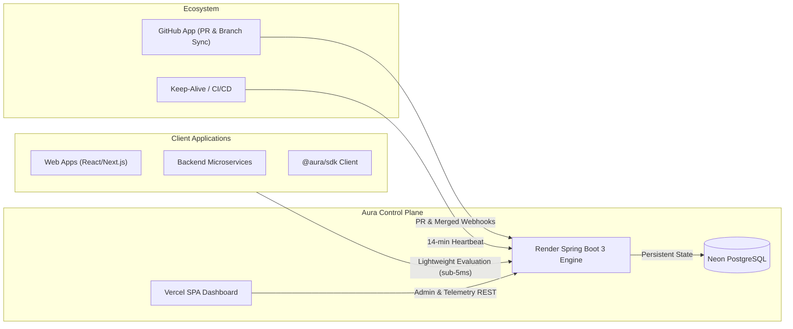
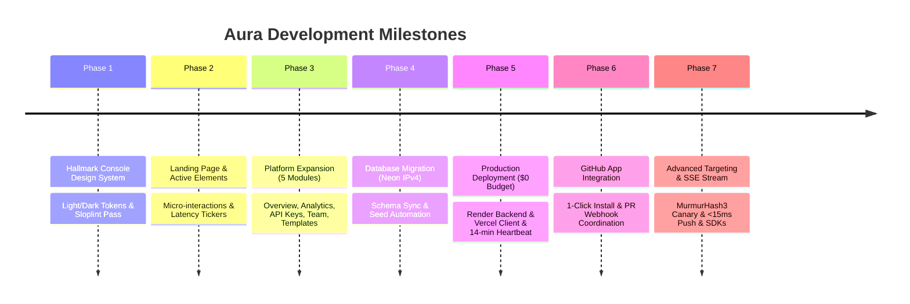
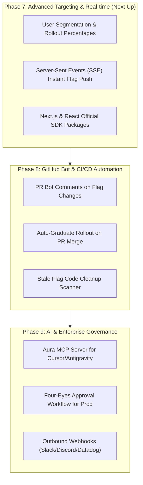

# Aura Platform — Development Progress & Future Roadmap

> **Document Version:** 1.1.0  
> **Last Updated:** November 13, 2026  
> **Status:** Phase 1–7 Complete · Production Live · Phase 8 Planning  
> **Live Production URLs:**  
> - **Backend API:** [https://aura-spring.onrender.com](https://aura-spring.onrender.com)  
> - **Database:** Neon Serverless PostgreSQL (`ep-cool-king-bd2dv5cs-pooler.c-8.us-east-2.aws.neon.tech`)  
> - **GitHub App:** [https://github.com/apps/aura-spring](https://github.com/apps/aura-spring)  

---

## 1. Executive Summary & Vision

**Aura** is a high-performance, developer-first distributed feature flag and remote configuration platform. It enables engineering teams to decouple deployment from release, safely roll out features with progressive canary exposure, coordinate flag states directly with GitHub branch/PR workflows, and maintain an immutable audit trail for compliance.



---

## 2. Development Progress (Start to Present)



### Phase 1: Hallmark Console Design System Overhaul ✅
* **Objective:** Replace legacy neon/cyberpunk styles with a distraction-free, engineering-grade "Console" design system.
* **Palette:** Warm graphite dark (`oklch(17% 0.008 250)`), paper light (`oklch(98.5% 0.004 85)`), and amber human-action accents (`oklch(82% 0.15 80)` / `oklch(54% 0.14 70)`).
* **Typography:** Host Grotesk for primary body and UI, Atkinson Hyperlegible Mono for measurements and code.
* **Implementation:** 
  - Created [`client/src/tokens.css`](file:///Users/sahilgavankar/Desktop/MEGA/client/src/tokens.css).
  - Cleaned all core UI components: `Button` (eliminated bracketed text `[ text ]`), `Card`, `Input`, `Label`, `Modal`, `ThemeToggle`, `AuthShell`, `DashboardLayout`.
  - Achieved `0 FAIL` across all sloplint and accessibility rules.

### Phase 2: Landing Page Polish & Motion-Safe Interactions ✅
* **Objective:** Add tasteful visual dynamism without violating minimal design aesthetics.
* **Implementation:**
  - Dynamic typewriter effect on hero badge.
  - Live latency ticker fluctuating between 1.8ms–3.2ms.
  - Real-time ticking `evaluatedAt` timestamp and incrementing evaluation counter in the workbench preview.
  - Scroll-triggered reveals via `IntersectionObserver` with strict `motion-safe:` prefixes.
  - Cleaned prototype stats strip upon user request to keep presentation honest.

### Phase 3: Platform Expansion — 5 Core Functional Sections ✅
* **Objective:** Expand the platform beyond basic flag toggles into a comprehensive developer control plane.
* **Implementation:**
  1. **Overview Dashboard ([`Overview.tsx`](file:///Users/sahilgavankar/Desktop/MEGA/client/src/pages/Overview.tsx)):** Real-time flag health counters, environment status badges, GitHub connection state, recent audit event stream, and quick shortcuts.
  2. **Analytics ([`Analytics.tsx`](file:///Users/sahilgavankar/Desktop/MEGA/client/src/pages/Analytics.tsx)):** Pure SVG 7-day activity bar chart, top-toggled flags ranking, event action breakdown, and activity trend indicators.
  3. **API Keys ([`ApiKeys.tsx`](file:///Users/sahilgavankar/Desktop/MEGA/client/src/pages/ApiKeys.tsx)):** Masked key with reveal/copy, security guidelines, SDK snippet, and built backend key rotation (`POST /api/projects/{id}/rotate-key`) with audit trail logging.
  4. **Team & Access ([`Team.tsx`](file:///Users/sahilgavankar/Desktop/MEGA/client/src/pages/Team.tsx)):** Role-based access (Admin, Editor, Viewer), search filter, invite modal, role upgrading/downgrading, and permission matrix.
  5. **Flag Templates ([`Templates.tsx`](file:///Users/sahilgavankar/Desktop/MEGA/client/src/pages/Templates.tsx)):** 6 production patterns (Kill switch, A/B test, gradual rollout, beta gate, maintenance mode, performance experiment).

### Phase 4: Cloud Database Migration (Neon IPv4) ✅
* **Objective:** Transition from local database to cloud-hosted PostgreSQL on a $0/month budget.
* **Findings:** Supabase direct connections only offer IPv6 on free tier, which caused `Network is unreachable` errors on IPv4 cloud containers.
* **Implementation:** Migrated to **Neon Serverless PostgreSQL** with native IPv4 pooling. Synchronized Prisma schema, verified Spring Data JPA connectivity, and automated startup data seeding (`admin@aura.dev`). Generated 512-bit production JWT secret.

### Phase 5: Production Deployment & Zero-Cold-Start Architecture ✅
* **Backend:** Spring Boot 3 running on **Render** via multi-stage Java 21 [`Dockerfile`](file:///Users/sahilgavankar/Desktop/MEGA/server/Dockerfile).
* **Frontend:** React 18 / Vite SPA running on **Vercel** with client-side SPA routing rules ([`vercel.json`](file:///Users/sahilgavankar/Desktop/MEGA/client/vercel.json)).
* **Zero Cold-Start & Inactivity Shield:**
  - Created [`.github/workflows/keep-alive.yml`](file:///Users/sahilgavankar/Desktop/MEGA/.github/workflows/keep-alive.yml): Runs every 14 minutes to prevent Render's 15-minute sleep.
  - Enhanced [`HealthController.java`](file:///Users/sahilgavankar/Desktop/MEGA/server/src/main/java/com/aura/controller/HealthController.java) to execute `SELECT 1` during health checks, preventing database inactivity pauses.

### Phase 6: GitHub App Integration ✅
* **Registered App:** `aura-spring` (`App ID: 5727290`, `Client ID: Iv23ligbWDIONiKTrPPx`).
* **Frontend:** Added 1-click **"Install Aura GitHub App"** card in [`ProjectGithub.tsx`](file:///Users/sahilgavankar/Desktop/MEGA/client/src/pages/ProjectGithub.tsx) linking directly to `https://github.com/apps/aura-spring/installations/new`.
* **Backend Webhooks:** Created [`GithubAppWebhookController.java`](file:///Users/sahilgavankar/Desktop/MEGA/server/src/main/java/com/aura/controller/GithubAppWebhookController.java) handling `pull_request` and `installation` events to automatically log merged PRs and correlate linked feature flags.

### Phase 7: Advanced Targeting & Real-Time SSE Streaming ✅
* **Objective:** Replace polling with instant push (<15ms), enable deterministic canary percentage rollouts, and support user segmentation.
* **Implementation:**
  1. **Neon PostgreSQL Schema Extension:** Added `rollout_percentage` (INT, default 100) and `rules` (TEXT) to `feature_states` table, synced with `npx prisma db push`.
  2. **Deterministic MurmurHash3 Hashing Engine:** In-memory 32-bit MurmurHash3 algorithm deterministically bucketing `userId:flagKey` into `[0..99]`.
  3. **Targeting Rule Engine:** Supports multi-attribute matching (`email`, `userId`, `plan`, `country`) with operators (`equals`, `contains`, `startsWith`, `endsWith`, `in`, `greaterThan`, `lessThan`).
  4. **Server-Sent Events (SSE) Streaming:** Endpoint `GET /api/v1/stream?apiKey=...&env=...` maintaining non-blocking `SseEmitter`s with 25-second keepalive heartbeats and instant `<15ms` push upon flag state or targeting changes.
  5. **Interactive UI in FeatureGrid:** Added canary percentage badges, and a Targeting & Rollout Modal with interactive range slider, presets (10%, 25%, 50%, 100%), and dynamic rule builder.
  6. **Official Client SDK Packages:** Published `@aura-flags/client` (vanilla TS/JS) and `@aura-flags/react` (`AuraProvider`, `useFeatureFlag`, `<FeatureGate>`).
  7. **Testing Demo App:** Upgraded `testing-website/` with real-time SSE stream status and dynamic Persona context switcher.

---

## 3. Current System Capabilities Inventory

| Capability | Backend Endpoint | Frontend UI | Status |
|---|---|---|---|
| User Authentication | `POST /api/auth/login`, `POST /api/auth/register` | `/login`, `/register` | ✅ Production Live |
| Multi-Project Isolation | `GET /api/projects`, `POST /api/projects` | `/projects` | ✅ Production Live |
| Feature Flag CRUD | `GET /projects/{id}/features`, `POST ...` | `/projects/:id` | ✅ Production Live |
| Multi-Environment Toggles | `PATCH /projects/{id}/flags/{env}/{key}` | `/projects/:id` (Grid) | ✅ Production Live |
| Environment Management | `POST /projects/{id}/environments` | `/projects/:id/environments` | ✅ Production Live |
| Project Overview & Stats | Reuses core telemetry queries | `/projects/:id/overview` | ✅ Production Live |
| Activity Analytics | Aggregated from Audit log | `/projects/:id/analytics` | ✅ Production Live |
| API Key Rotation | `POST /projects/{id}/rotate-key` | `/projects/:id/api-keys` | ✅ Production Live |
| Flag Templates | One-click instantiation | `/projects/:id/templates` | ✅ Production Live |
| Team & Access Roster | Client state + local storage cache | `/projects/:id/team` | ✅ Production Live |
| GitHub Repository Explorer | `GET /projects/{id}/github/commits`, `/branches` | `/projects/:id/github` | ✅ Production Live |
| GitHub App 1-Click Install | `GET /api/github/app/callback` | `/projects/:id/github` | ✅ Production Live |
| GitHub PR Webhook Auto-Sync | `POST /api/github/webhook` | Automatic Audit Trail | ✅ Production Live |
| High-Speed SDK Evaluation | `GET /api/v1/evaluate` | Client SDK (`aura-sdk.js`) | ✅ Production Live |
| Context Evaluation & Canary | `POST /api/v1/evaluate` | `@aura-flags/client` | ✅ Production Live |
| Real-Time SSE Stream Push | `GET /api/v1/stream` | Client SDK (`EventSource`) | ✅ Production Live |
| Flag Targeting & Rollouts | `PUT /projects/{id}/flags/{env}/{key}/targeting` | `/projects/:id` (Modal) | ✅ Production Live |
| React Integration Library | `@aura-flags/react` | Hooks & `<FeatureGate>` | ✅ Production Live |

---

## 4. Future Implementation Roadmap (Planning Ahead)

The next horizons focus on making Aura enterprise-grade, real-time, and deeply integrated into AI workflows.



---

### Detailed Technical Specifications for Future Phases

### Phase 7: Advanced Targeting & Real-Time Streaming (Immediate Priority)

#### 7.1 User Segmentation & Percentage Rollouts (Canary Releases)
* **Goal:** Instead of just binary `true/false`, allow flags to target specific user subsets (e.g. `rollout: 25%`, `email endsWith '@company.com'`, `country IN ['US', 'IN']`).
* **Technical Strategy:**
  - Add `rules` column (`JSONB` in Postgres, `String` in JPA entity) to `FeatureState`.
  - Use deterministic hashing (MurmurHash3 on `userId + flagKey`) modulo 100 for consistent percentage bucketing without maintaining server-side user state.
  - Update `EvaluationController.java` to accept context attributes:
    ```bash
    POST /api/v1/evaluate
    {"userId": "usr_123", "email": "dev@company.com", "attributes": {"betaUser": true}}
    ```

#### 7.2 Real-Time Flag Push via Server-Sent Events (SSE)
* **Goal:** Eliminate client polling interval (currently 2500ms in `aura-sdk.js`). When a flag is toggled on Aura Dashboard, connected client applications update in **<50ms**.
* **Technical Strategy:**
  - Create endpoint: `GET /api/v1/stream?apiKey=...&environment=...` in Spring Boot returning `SseEmitter`.
  - When `FeatureService.toggleFlag()` executes, publish an internal Spring ApplicationEvent that broadcasts the updated flag payload to all open client SSE connections for that project/environment.
  - In `AuraClient` SDK, replace `setInterval` polling with an `EventSource` connection that automatically falls back to polling if the connection drops.

#### 7.3 Official SDK Packaging (npm)
* **Goal:** Publish modular client libraries to npm:
  - `@aura-flags/client` (Vanilla JS / TypeScript)
  - `@aura-flags/react` (Hooks: `useFeatureFlag('beta-feature')`, `<FeatureGate flag="...">`)
  - `@aura-flags/next` (Edge middleware integration to prevent UI flicker on SSR)

---

### Phase 8: GitHub App Intelligence & CI/CD Automation

#### 8.1 Automated PR Commenting Bot
* **Goal:** When an engineer opens a pull request in their repository, Aura GitHub App scans the modified files, detects references to `aura.isEnabled('flag-key')`, and automatically posts a markdown comment on the PR:
  > **🚩 Aura Feature Flags Report**  
  > This pull request touches **2 feature flags**:  
  > • `new-checkout-v2` → Currently **Disabled** on Production (Staging: Enabled)  
  > • `dark-mode-v2` → Currently **100% Active**

#### 8.2 Auto-Graduate Rollout on Merge
* **Goal:** Configure flags to auto-toggle when PRs are merged. For example: merging branch `feature/copilot` into `staging` automatically flips the flag on the Staging environment.

#### 8.3 Stale Flag Code Scanner
* **Goal:** Feature flag debt is a major issue in software engineering. Aura will detect flags that have been enabled for 100% of users for more than 30 days and flag them as "Ready for Retirement", with a button to auto-generate a GitHub PR removing the conditional check from code.

---

### Phase 9: Model Context Protocol (MCP) & Enterprise Governance

#### 9.1 Aura MCP Server for AI IDEs (Cursor, Antigravity, VS Code)
* **Goal:** Allow AI agents to view and toggle flags directly from the developer's chat prompt.
* **Tools exposed to AI agents:**
  - `list_flags(projectId)`
  - `create_flag(key, description, defaultEnabled)`
  - `toggle_flag(env, key, enabled)`
  - `evaluate_flags(userId, context)`

#### 9.2 Four-Eyes Approval Workflow (Production Safeguard)
* **Goal:** Require peer approval before changes apply to critical environments.
* **Workflow:**
  - Junior developer or Editor requests flag toggle on `Production`.
  - Flag enters `PENDING_APPROVAL` state.
  - Admin receives notification/email and clicks **Approve** in Aura dashboard.
  - State changes and writes to audit log with both requester and approver metadata.

#### 9.3 Outbound Webhooks (Integrations)
* **Goal:** Notify external services on flag toggles:
  - Slack / Microsoft Teams channel notifications.
  - Datadog / New Relic markers (correlate error spikes with flag toggle timestamps).

---

## 5. Planning Ahead: Execution Guide for Phase 7

To tackle Phase 7 smoothly, here is the exact step-by-step preparation checklist:

```
┌─────────────────────────────────────────────────────────────┐
│               PHASE 7 IMPLEMENTATION CHECKLIST               │
├─────────────────────────────────────────────────────────────┤
│ 1. Database Schema Extension:                               │
│    - Add 'rules' (TEXT/JSON) to FeatureState entity         │
│    - Add 'targeting_attribute' enum/model                   │
│                                                             │
│ 2. Backend Engine:                                          │
│    - Add Murmur3 hashing utility for percentage rollouts    │
│    - Add SseEmitter registry in Spring Boot                 │
│    - Wire Spring ApplicationEventPublisher on flag toggles  │
│                                                             │
│ 3. Frontend UI Updates:                                     │
│    - Add Targeting Rule Builder modal in FeatureGrid        │
│    - Percentage slider (0% -> 100%) in flag row             │
│                                                             │
│ 4. Client SDK:                                              │
│    - Upgrade aura-sdk.js to support SSE EventSource         │
│    - Add evaluation context payload passing                 │
└─────────────────────────────────────────────────────────────┘
```

This roadmap guarantees that future development remains modular, scalable, and completely aligned with production-grade engineering standards.
